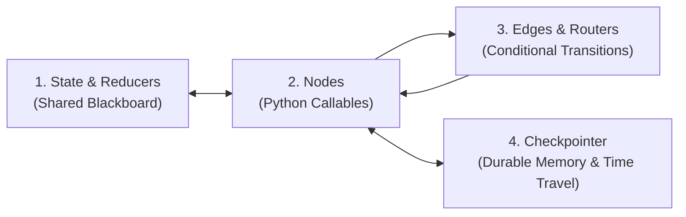

# 📐 StateCraft: High-Level Architecture Guide

StateCraft is a production-grade framework demonstrating **stateful agentic workflows** built on **LangGraph** and **LangChain**. It bridges the gap between toy linear LLM chains and enterprise-grade autonomous systems capable of self-healing, resilience, and human oversight.

---

## 1. Why Stateful Graphs over Linear Chains & DAGs?

| Dimension | Linear Chain (LCEL / LangChain Runnables) | Standard DAG (Airflow / Prefect) | Stateful Graph (LangGraph) |
| :--- | :--- | :--- | :--- |
| **Topology** | Sequential (A → B → C) | Directed Acyclic Graph (No cycles) | **Cyclic Graph (Loops, feedback & recursion)** |
| **State Model** | Ephemeral context passed down pipe | Task outputs stored in external DB | **First-class State Schema with Reducer Channels** |
| **Self-Correction** | ❌ Cannot loop back to fix errors | ❌ Hard to reflect on intermediate errors | **✅ Native Evaluator-Optimizer loops** |
| **Human-in-the-Loop** | ❌ Hard to pause asynchronously | ⚠️ Heavyweight worker task polling | **✅ Native `interrupt()` & `Command(resume=...)`** |
| **Time Travel** | ❌ Lost upon completion | ⚠️ Manual replay of DAG tasks | **✅ Native Checkpoint forks & state replay** |

---

## 2. Core Mental Model: The 4 Pillars of LangGraph



1. **State**: A schema (typically a `TypedDict` or Pydantic `BaseModel`) that represents the current snapshot of truth. Nodes do not mutate this directly; they return state updates.
2. **Nodes**: Pure or stateful Python functions `f(state: S) -> Dict[str, Any]` that accept the state, perform computation or LLM tool invocations, and return partial dictionaries of updates.
3. **Edges**: Direct links or conditional routing functions `f(state: S) -> str` that determine which node executes next based on state values.
4. **Checkpointer**: A persistence layer (`MemorySaver`, `SqliteSaver`, `PostgresSaver`) that saves an immutable state snapshot before and after every step, keyed by a `thread_id`.

---

## 3. High-Level System Architecture

StateCraft implements five foundational patterns and unifies them into a flagship enterprise software release engine:

```mermaid
flowchart TD
    subgraph Enterprise_Pipeline ["Flagship: Autonomous Release & Security Gate"]
        START([User Requirement Ticket]) --> Triage[1. Triage & Risk Branching]
        
        Triage -->|TIER_1: Standard| FastPrep[Standard Fast-Track]
        Triage -->|TIER_2/3: High Risk| ResilientFetch[2. Resilient Policy Fetch<br/><i>Exponential Retries</i>]
        
        ResilientFetch --> SpecGen[3. Spec & Code Synthesis]
        FastPrep --> SpecGen
        
        SpecGen --> Evaluator[4. Evaluator-Optimizer<br/><i>AST & Unit Test Sandbox</i>]
        
        Evaluator -->|Tests Fail & Cycles < Max| SpecGen
        Evaluator -->|Tests Pass| GovernanceGate{Requires Human Sign-off?}
        
        GovernanceGate -->|TIER_1 Low Risk| Deploy[6. Production Deployment]
        GovernanceGate -->|TIER_2/3 Elevated| HITL[5. Human Governance Checkpoint<br/><b>interrupt()</b>]
        
        HITL -->|<Human Review Decision>| VerdictRouter{Decision}
        VerdictRouter -->|Approve / Edit| Deploy
        VerdictRouter -->|Reject| Abort[Incident Abort & Archival]
        
        Deploy --> END([Production Release Live])
        Abort --> END
    end
```

---

## 4. Pattern Overview & When to Use

### Pattern 1: Dynamic Branching & Conditional Routing
- **Problem**: Monolithic pipelines send simple queries through heavy reasoning steps (high latency/cost) and complex queries through shallow steps (low accuracy).
- **Solution**: A classifier node scores intent and risk, dynamically routing requests into specialized branches (Security Audit, Technical Solver, Billing, or Fast-Path Cache).

### Pattern 2: Self-Correction & Evaluator-Optimizer Loop
- **Problem**: Single-pass LLM code generation fails on boundary edge cases and syntax errors.
- **Solution**: Code is evaluated in an isolated execution sandbox. Failed test assertions and stderr traces are structured as critiques and fed back into state, allowing the LLM to reflect and correct itself up to a bounded iteration budget.

### Pattern 3: Resilience, Retries & Fallback Circuit
- **Problem**: Remote microservices, vector DBs, and LLM APIs experience transient 429 rate limits and 503 outages.
- **Solution**: Graph-level state retry loop with jittered exponential backoff and circuit-breaker tripping to an L2 fallback cache.

### Pattern 4: Human-in-the-Loop (HITL) Checkpoints & Time Travel
- **Problem**: Fully autonomous agents lack governance and safety guardrails in high-stakes production operations.
- **Solution**: Native LangGraph `interrupt()` pauses execution and commits state to a checkpointer. A human reviewer can approve, edit state variables directly, or reject. Resumption is triggered via `Command(resume=...)`.

### Pattern 5: Hierarchical Supervisor & Multi-Agent Subgraphs
- **Problem**: Complex workflows exceed the context window and specialized reasoning abilities of a single prompt.
- **Solution**: A central Supervisor Coordinator delegates discrete subtasks to specialized subagents (`Researcher`, `Engineer`, `Auditor`), tracks progress in state, and synthesizes a final executive briefing.

---

## 5. Architectural Trade-Offs

| Architecture Decision | Chosen Approach | Alternative Considered | Trade-Off Rationale |
| :--- | :--- | :--- | :--- |
| **State Typing** | `TypedDict` with Reducers | Pydantic `BaseModel` | `TypedDict` offers native partial dictionary updates and zero serialization overhead in LangGraph channels. |
| **Human Pause Mechanism** | `interrupt()` + `Command(resume)` | Breakpoints on nodes (`interrupt_before`) | `interrupt()` allows dynamic in-node payloads and custom resume parameters without hard-coding static breakpoint lists. |
| **Multi-Agent Coordination** | Hierarchical Supervisor | Decentralized Peer-to-Peer Agent Mesh | Supervisor guarantees deterministic termination, centralized telemetry, and avoids infinite ping-pong between agents. |
| **Resilience Layer** | State-level retry loops with backoff | Global library decorators (`@retry`) | State-level loops record every failure into the persistent audit trail, enabling UI visibility and circuit-breaker state tracking. |
