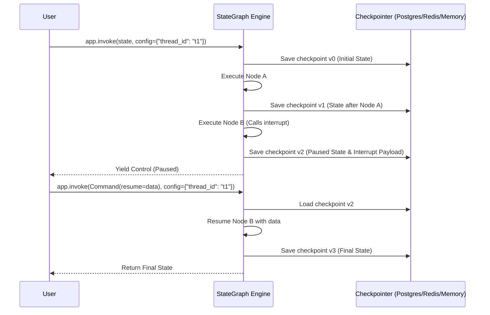

# 🔬 StateCraft: Low-Level Engineering Deep-Dive

This document provides a low-level, code-centric breakdown of the internal mechanics powering StateCraft with **LangGraph 1.2+**.

---

## 1. Graph State & Channel Reducer Mechanics

In LangGraph, state is not a global mutable dictionary. It is divided into **Channels**.
When a node returns a dictionary `{"key": value}`, LangGraph applies the channel's **Reducer Function** to merge the update into the existing state.

### Overwrite vs. Append Channels

```python
from typing import TypedDict, Annotated, List, Any
import operator

# 1. Custom append reducer supporting single items or lists
def append_list(current: List[Any], new: Any) -> List[Any]:
    if current is None:
        current = []
    if isinstance(new, list):
        return current + new
    return current + [new]

class SystemState(TypedDict, total=False):
    # Overwrite channel: Returning {"status": "LIVE"} replaces the old status
    status: str
    
    # Reducer channel: Returning {"logs": "New log"} appends to existing list monotonically
    logs: Annotated[List[str], append_list]
    
    # Built-in operator.add reducer
    metrics: Annotated[List[float], operator.add]
```

### Why Reducers Matter:
- Prevents race conditions and unintended clobbering in parallel branches.
- Creates an append-only, tamper-evident audit trail of agent thoughts, tool outputs, and human decisions.

---

## 2. Checkpointing, Threads & State Persistence

Checkpointers enable workflows to survive process crashes, scale across serverless containers, and pause for human intervention.

```python
from langgraph.checkpoint.memory import MemorySaver
# In production, replace MemorySaver with PostgresSaver or SqliteSaver:
# from langgraph.checkpoint.postgres import PostgresSaver

checkpointer = MemorySaver()
app = graph.compile(checkpointer=checkpointer)

# Every execution is bound to a thread_id
config = {"configurable": {"thread_id": "thread-user-4029"}}
```

### Checkpoint Lifecycle:


---

## 3. Human-in-the-Loop: `interrupt()` & `Command(resume=...)`

In modern LangGraph 1.2+, `interrupt()` replaces the legacy static `interrupt_before` lists with **dynamic, in-line payload interrupts**.

### Halting Execution in a Node:
```python
from langgraph.types import interrupt

def human_governance_checkpoint(state: EnterprisePipelineState):
    # 1. Define the payload for external UI / Slack bot / CLI
    review_payload = {
        "ticket_id": state["ticket_id"],
        "code_to_review": state["code_solution"],
        "prompt": "Elevated risk ticket. Review and approve."
    }
    
    # 2. HALTS HERE. Yields control back to the caller.
    human_decision = interrupt(review_payload)
    
    # 3. Code below runs ONLY when resumed!
    return {
        "human_decision": human_decision,
        "status": "APPROVED" if human_decision["action"] == "approve" else "REJECTED"
    }
```

### Resuming from an External Process:
```python
from langgraph.types import Command

# Inspect paused thread
current_state = app.get_state(config)
print("Is thread paused?", current_state.next)

# Resume with human decision
resume_cmd = Command(resume={
    "action": "edit",
    "feedback": "Optimized memory allocation bounds.",
    "edited_content": "def calculate_moving_average(...): ...",
    "reviewed_by": "lead.secops@corp.internal"
})

resumed_state = app.invoke(resume_cmd, config=config)
```

---

## 4. Evaluator-Optimizer & Isolated AST Code Sandbox

Self-correction requires verifiable, deterministic ground truth rather than LLM self-delusion. StateCraft uses a 2-stage verification pipeline:

1. **Static AST Analysis**: Verifies Python syntax validity without executing code (`ast.parse(code)`).
2. **Namespace Sandbox Execution**: Executes code in an isolated dictionary scope with strict test assertions:

```python
import ast

def evaluate_candidate(state: SelfCorrectionState) -> Dict[str, Any]:
    code = state["code"]
    
    # Stage 1: Syntax check
    try:
        ast.parse(code)
    except SyntaxError as e:
        return {
            "feedback": {"passed": False, "critique": f"SyntaxError line {e.lineno}: {e.msg}"}
        }

    # Stage 2: Sandboxed Functional Assertions
    sandbox = {}
    try:
        exec(code, sandbox)
        fn = sandbox["calculate_moving_average"]
        assert fn([10, 20, 30, 40], 2) == [15.0, 25.0, 35.0]
        assert fn([], 2) == []
        return {"feedback": {"passed": True, "critique": "All tests passed."}}
    except AssertionError as ae:
        return {"feedback": {"passed": False, "critique": f"Assertion failed: {ae}"}}
    except Exception as exc:
        return {"feedback": {"passed": False, "critique": f"Runtime error: {exc}"}}
```

---

## 5. Time-Travel & State History Replay

Because every checkpoint is indexed by `(thread_id, checkpoint_id)`, LangGraph allows **time-travel debugging**:

```python
# Retrieve full historical timeline of state snapshots
for state_snapshot in app.get_state_history(config):
    print(f"Checkpoint ID: {state_snapshot.config['configurable']['checkpoint_id']}")
    print(f"Step Created: {state_snapshot.created_at}")
    print(f"Next Nodes: {state_snapshot.next}")
    print(f"Values at this point: {state_snapshot.values}")
```

To fork from a prior checkpoint or test an alternative path:
```python
# Pass checkpoint_id in config to replay from the past
historical_config = {
    "configurable": {
        "thread_id": "thread-user-4029",
        "checkpoint_id": "1ef9a820-..."
    }
}
app.invoke(new_input, config=historical_config)
```
